<a id="top"></a>
<p align="center">
  <a href="#russian"></a>
  <a href="#english"></a>
</p>

---

<a id="russian"></a>

# 🇷🇺 Portal-Windows (Русская версия)

<p align="center">
  <a href="https://github.com/KoksMen/Portal-Windows">
    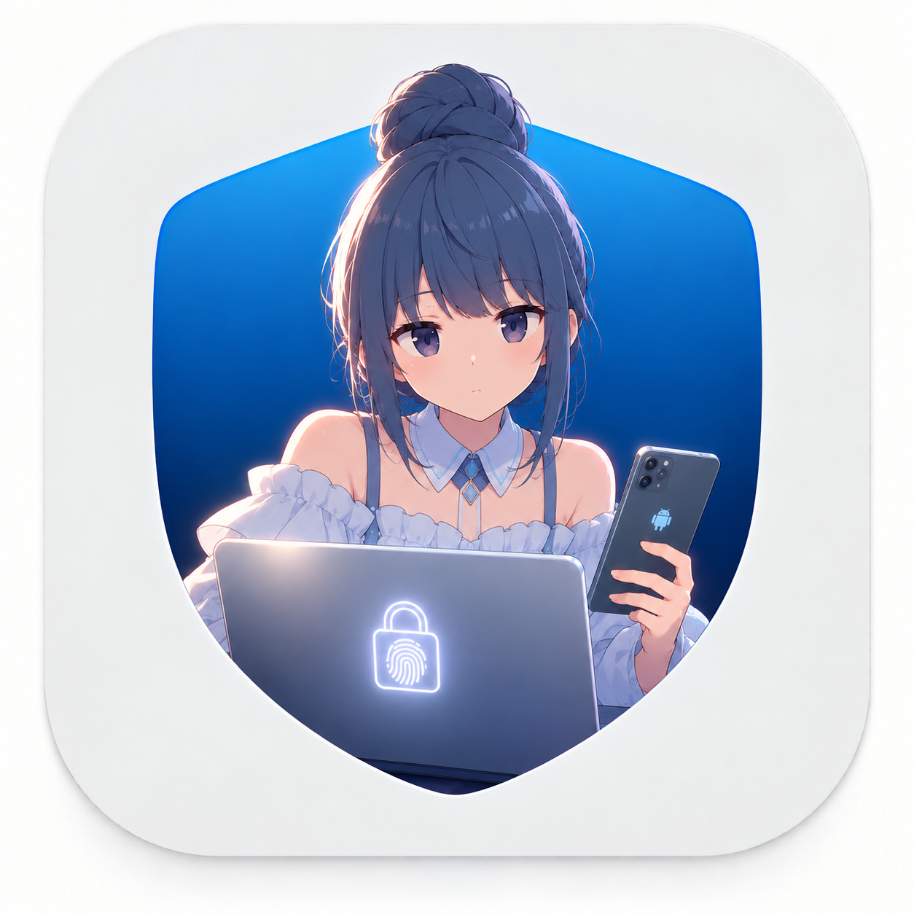
  </a>
</p>

<h1 align="center">✨ Portal-Windows ✨</h1>
<h3 align="center">🔮 Кодовое имя: <em>Herta</em> (v1.9.5) 🪄</h3>

<p align="center">
  <b>Мгновенная биометрическая разблокировка Windows с телефона и смарт-часов без ввода пароля</b><br>
  <i>Бесшовная интеграция в системный экран входа (LogonUI) и диалоги подтверждения прав администратора (UAC)</i>
</p>

<p align="center">
  <a href="https://github.com/KoksMen/Portal-Windows/releases"></a>
  
  
  <a href="https://play.google.com/store/apps/details?id=com.xxmrk888ytxx.portal"></a>
  
  <a href="LICENSE.txt"></a>
</p>

<p align="center">
  <b>🇷🇺 Русский</b> • <a href="#english"><b>🇬🇧 English (читать ниже ↓)</b></a>
</p>

<p align="center">
  <a href="https://github.com/KoksMen/Portal-Windows/releases/latest">
    
  </a>
  <a href="https://play.google.com/store/apps/details?id=com.xxmrk888ytxx.portal">
    
  </a>
  <a href="https://github.com/xXMRK888YTXx/Portal-Android">
    
  </a>
</p>

<p align="center">
  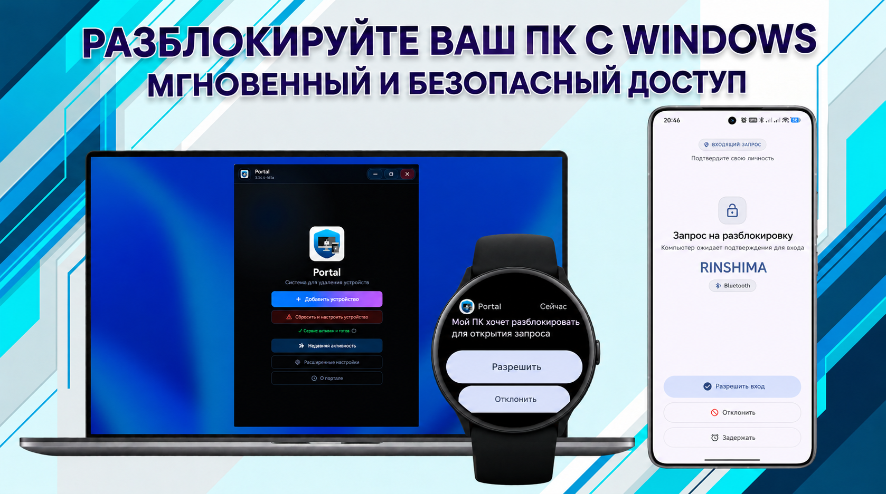
</p>

---

<p align="center">
  <a href="#about-ru">💡 О проекте</a> • 
  <a href="#matrix-ru">📊 Сравнение</a> • 
  <a href="#demo-ru">🎬 Демонстрация</a> • 
  <a href="#quick-ru">🚀 Быстрый старт</a> • 
  <a href="#host-ui-ru">🖥️ Приложение Portal.Host</a> • 
  <a href="#logon-ru">🪟 Экран входа Windows 11</a> • 
  <a href="#play-screens-ru">📱 Google Play Маркет</a> • 
  <a href="#wear-ru">⌚ Смарт-часы Wear OS</a> • 
  <a href="#modes-ru">🎛️ Режимы работы</a> • 
  <a href="#channels-ru">📡 Каналы связи</a> • 
  <a href="#security-ru">🛡️ Безопасность</a> • 
  <a href="#features-ru">🌟 Все возможности</a> • 
  <a href="#troubleshoot-ru">🧰 Диагностика</a> • 
  <a href="#arch-ru">🧩 Архитектура</a> • 
  <a href="#build-ru">💻 Сборка</a> • 
  <a href="#license-ru">📄 Лицензия</a>
</p>

---

<a id="about-ru"></a>
## 💡 О проекте Portal-Windows

**Portal-Windows** — нативный системный модуль **Windows Credential Provider V2** и сопутствующий хост-сервис (`Portal.Host` на базе WPF / .NET 10), превращающий ваш Android-смартфон и часы Wear OS в защищённый аппаратный ключ безопасности для входа в Windows.

Забудьте о ручном вводе сложных паролей при включении компьютера, выходе из спящего режима или подтверждении системных привилегий:
- 👆 **Биометрия в одно касание:** Отпечаток пальца (Touch ID / Fingerprint) или распознавание лица (Face Unlock) на смартфоне.
- ⌚ **Мгновенный аппрув с часов:** Уведомление на часах Wear OS с кнопкой «Разрешить» прямо на запястье.
- 🔒 **100% P2P и Zero-Cloud:** Пароль зашифрован в защищённом системном хранилище Windows LSA Secret Store и **никогда не покидает ваш компьютер**.
- 🛡️ **Поддержка системных окон UAC:** Подтверждайте диалоги повышения прав учетной записи без ввода пароля администратора.

---

<a id="matrix-ru"></a>
## 📊 Сравнение с альтернативами

| Характеристика | Обычный пароль | Windows Hello (камера/сканер) | Облачные решения | **Portal-Windows** |
| :--- | :---: | :---: | :---: | :---: |
| **Скорость ввода** | ❌ Медленно | ⚡ Быстро | ⚡ Быстро | ⚡ **Мгновенно (P2P)** |
| **Оборудование ПК** | ❌ Клавиатура | ❌ Нужна IR-камера / USB-сканер | ❌ Облачный сервер | ✅ **Любой ПК (ноутбук/десктоп)** |
| **Работа без интернета** | ✅ Да | ✅ Да | ❌ Нет (нужен интернет) | ✅ **Да (локальная сеть / BT)** |
| **Конфиденциальность** | ⚠️ Риск подглядывания | ✅ Локально | ❌ Данные уходят на сервера | 🛡️ **Zero-Cloud, mTLS X.509** |
| **Поддержка умных часов** | ❌ Нет | ❌ Нет | ⚠️ Редко | ⌚ **Wear OS (из коробки)** |
| **Разблокировка спящего ПК** | ❌ Нет | ❌ Нет | ⚠️ Сложно | ⚡ **Wake-on-LAN (встроен)** |
| **Поддержка диалогов UAC** | ❌ Ручной ввод | ⚠️ Не всегда | ❌ Нет | ✅ **Нативно интегрировано** |

---

<a id="demo-ru"></a>
## 🎬 Как это выглядит в работе

Живой интерактивный прогресс-бар прямо на плитке пользователя LogonUI, мгновенный запрос на телефоне, отпечаток — и рабочий стол открыт:

<p align="center">
  
</p>

Аналогичный механизм работает для системных запросов **UAC**:

<p align="center">
  
</p>

---

<a id="quick-ru"></a>
## 🚀 Быстрый старт за 60 секунд

### Системные требования

| Компонент | Требование |
| :--- | :--- |
| 🪟 **Операционная система** | Windows 10 (версия 1809+) или Windows 11, x64 |
| ⚙️ **Среда выполнения** | .NET 10.0 Desktop Runtime *(уже включена в релизный дистрибутив)* |
| 📱 **Мобильное устройство** | Android 8.0+ со сканером отпечатка пальца / Face Unlock |
| ⌚ **Смарт-часы (опционально)** | Умные часы на Wear OS 3.0+ |

### Инструкция по установке

<p align="center">
  
</p>

1. **Установите мобильный клиент** из [Google Play](https://play.google.com/store/apps/details?id=com.xxmrk888ytxx.portal) или скачайте APK из [репозитория Android](https://github.com/xXMRK888YTXx/Portal-Android/releases).
2. **Скачайте Portal-Windows** — архив `PortalWin-1.9.5-win-x64.zip` со страницы [GitHub Releases](https://github.com/KoksMen/Portal-Windows/releases/latest).
3. **Распакуйте в постоянную папку** (например, `C:\Program Files\Portal`) и запустите `Portal.Host.exe` **от имени администратора**.
4. **Нажмите «СТАРТ»** — приложение зарегистрирует COM-провайдер и настроит правила брандмауэра Windows.
5. **Сопряжение за секунды:**
   - Нажмите вкладку **«Устройства»** $\rightarrow$ **«+ Добавить устройство»**.
   - В мобильном приложении нажмите **«+»** $\rightarrow$ выберите Wi-Fi или Bluetooth $\rightarrow$ отсканируйте QR-код на мониторе.
6. **Готово!** Заблокируйте ПК комбинацией <kbd>Win</kbd> + <kbd>L</kbd> и прикоснитесь к сканеру отпечатка пальца на телефоне. 🎉

---

<a id="host-ui-ru"></a>
## 🖥️ Десктопное приложение Portal.Host

Хост-сервис обладает современным графическим интерфейсом на базе **WPF** и дизайн-системы **Fluent Design**:

| 🖥️ Главное окно Portal.Host | 📡 Выбор протокола привязки |
| :---: | :---: |
| 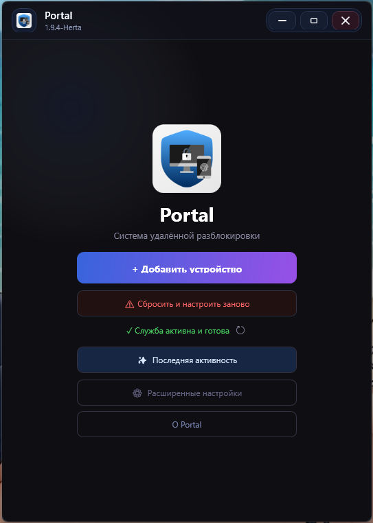 | 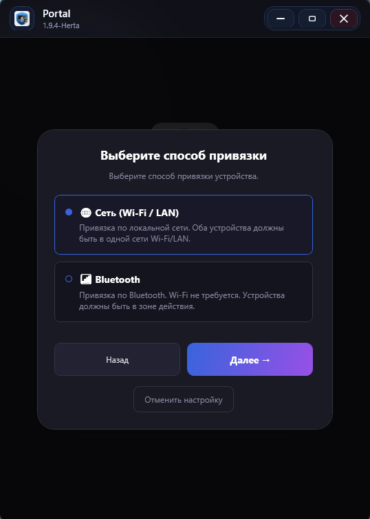 |
| *Мониторинг службы, список устройств и журнал активности* | *Мастер сопряжения по локальной сети Wi-Fi или Bluetooth* |

---

<a id="logon-ru"></a>
## 🪟 Реальный экран входа Windows 11 (LogonUI)

Модуль **Portal.CredentialProvider** бесшовно встраивается в экран входа Windows 10/11:

<p align="center">
  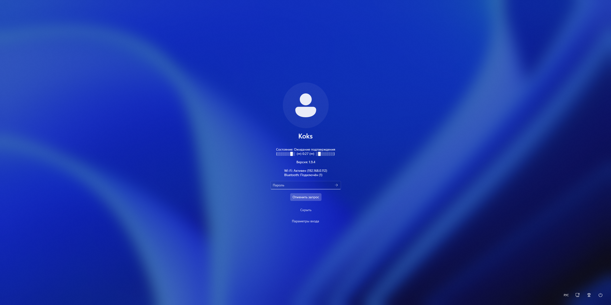
</p>

*На экране отображается статус сетевого обнаружения, IP-адрес Wi-Fi, статус Bluetooth и интерактивный обратный отсчёт ожидания биометрии.*

---

<a id="play-screens-ru"></a>
## 📱 Официальные постеры Google Play Маркета (RU)

| 📱 1. Управление устройствами | 🛡️ 2. Настройка безопасности | ⚡ 3. Создание ярлыков |
| :---: | :---: | :---: |
| 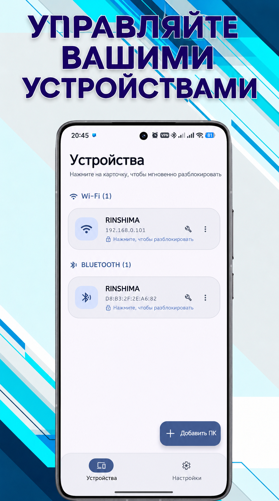 | 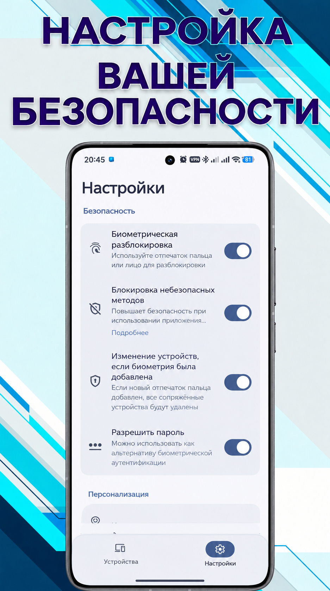 | 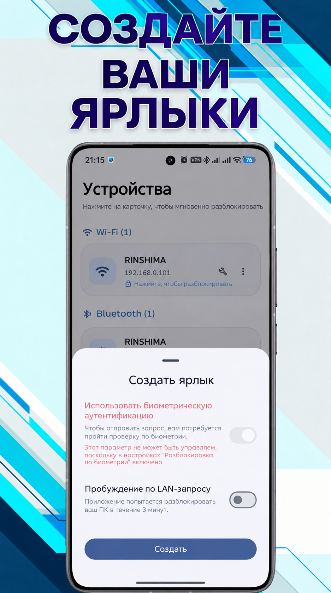 |
| *Мгновенный выбор ПК (Wi-Fi / BT)* | *Биометрия, защита от подбора и сброс ключей* | *Ярлыки на рабочем столе и Wake-on-LAN* |

---

<a id="wear-ru"></a>
## ⌚ Приложение для смарт-часов Wear OS

Приложение-компаньон для часов Wear OS позволяет подтверждать вход и управлять питанием ПК прямо с запястья:

| ⌚ 1. Быстрый статус | 🔓 2. Разблокировка | ⚙️ 3. Меню протоколов | ☕ 4. Wake-on-LAN |
| :---: | :---: | :---: | :---: |
| 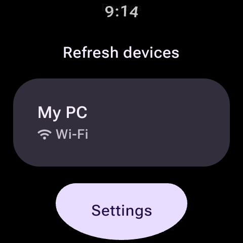 | 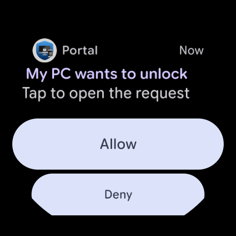 | 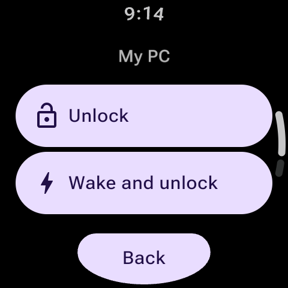 | 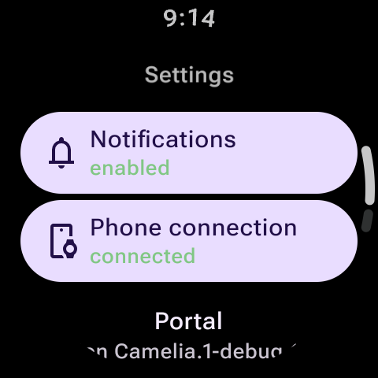 |
| *Список ПК на запястье* | *Кнопка мгновенного входа* | *Выбор Wi-Fi / Bluetooth* | *Дистанционное включение* |

- **Принцип «Первое решение побеждает»:** Подтверждение на часах мгновенно закрывает всплывающее окно на смартфоне.
- **Безопасность метаданных:** Пароли учётных записей никогда не передаются на часы — часы обмениваются только подписанными крипто-маркерами сессий.

---

<a id="modes-ru"></a>
## 🎛️ 3 удобных режима разблокировки ПК

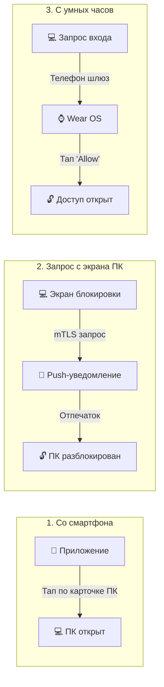

1. **Режим 1: Со смартфона (Client-Initiated)** — вы подходите к компьютеру, нажимаете на плитку ПК в приложении или ярлык на рабочем столе смартфона, и компьютер сразу разблокирован.
2. **Режим 2: Запрос с ПК (Host-Initiated)** — садитесь за компьютер, нажимаете клавишу или будите ПК. Windows сама отправляет запрос на авторизованный телефон. Вы прикладываете палец — сессия активна.
3. **Режим 3: Умные часы (Wear OS)** — телефон лежит в кармане или на зарядке. Вибрация на часах, нажатие кнопки «Разрешить» — компьютер готов к работе.

---

<a id="channels-ru"></a>
## 📡 Каналы связи и протоколы передачи

<p align="center">
  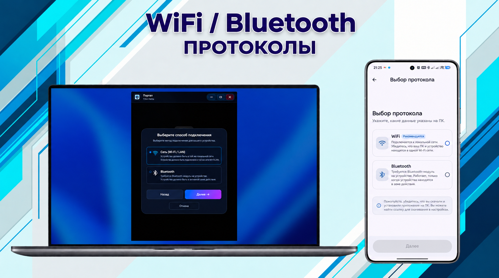
</p>

- **Высокоскоростной mTLS WebSocket:** Мгновенный отклик по локальной сети Wi-Fi/Ethernet (задержка RTT < 15 мс).
- **Прямой Bluetooth-канал (RFCOMM):** Работает полностью автономно, даже если роутер выключен или нет связи с локальной сетью.
- **Поддержка WireGuard и Wintun VPN:** Виртуальные интерфейсы автоматически отсекаются от mDNS-анонсов, связь со смартфоном остаётся стабильной при включённом VPN.
- **Дистанционный Wake-on-LAN:** Пробуждение компьютера из сна или гибернации «магическим пакетом» перед разблокировкой.

---

<a id="security-ru"></a>
## 🛡️ Архитектура безопасности

<p align="center">
  
</p>

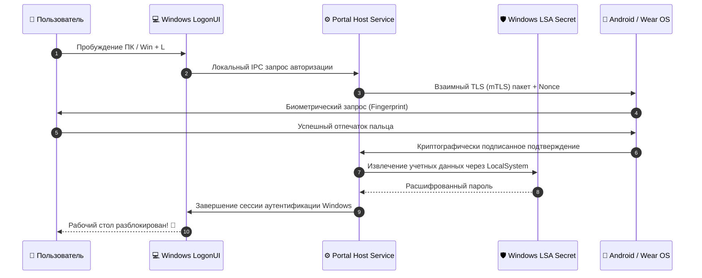

- 🔒 **Windows LSA Secret Store:** Пароли учетных записей хранятся исключительно в недрах системного хранилища Local Security Authority операционной системы. Доступ к ним имеет исключительно процесс ядра `LocalSystem`. Ни один сторонний процесс не может прочитать секрет.
- 🔐 **Взаимная аутентификация mTLS:** Соединение между ПК и смартфоном защищено двусторонними сертификатами X.509 с валидацией отпечатков SHA-256. Исключены атаки Man-in-the-Middle (MitM).
- 🛡️ **Zero-Knowledge & Zero-Cloud:** Никаких промежуточных серверов, телеметрии или баз данных в интернете. Связь работает только внутри локальной сети или по прямому Bluetooth.
- 🎯 **Защита от Replay-атак:** Каждая сессия генерирует одноразовый криптографический `RequestId` и временную метку (Nonce). Повторная отправка пакета невозможна.
- 🔑 **Опциональный 2FA PIN:** Для максимальной защиты можно активировать двухфакторный режим: биометрия на телефоне + ввод короткого PIN на клавиатуре ПК с защитой от подбора (3 попытки).

---

<a id="features-ru"></a>
## 🌟 Все возможности и инновации Windows-клиента

<details>
<summary><b>⏳ 1. Настраиваемый динамический прогресс-бар на экране входа</b></summary>

- Интерактивный таймер прямо под аватаром пользователя в LogonUI.
- 3 визуальных стиля индикатора: блочный `[████]`, тонкий `[━━━━]` и точечный `[●●●●]`.
- Плавная бегущая волна (marquee) в бесконечном режиме ожидания.

</details>

<details>
<summary><b>💾 2. Резервное копирование профиля (.portalbackup)</b></summary>

- Экспорт и импорт настроек, списка сопряжённых устройств и TLS-сертификатов в зашифрованный контейнер **AES-256-GCM** с защитой мастер-паролем (PBKDF2, 210 000 итераций).

</details>

<details>
<summary><b>🛡️ 3. Самовосстановление брандмауэра (Self-Repair Firewall)</b></summary>

- Автоматический аудит и мгновенное пересоздание разрешающих правил Windows Defender Firewall (TCP 51234 для mTLS и UDP 5353 для mDNS) при их случайном удалении антивирусами.

</details>

<details>
<summary><b>⚡ 4. Дистанционное пробуждение через Wake-on-LAN</b></summary>

- Если компьютер находится в режиме гибернации или глубокого сна, мобильное приложение отправляет защищённый «магический пакет» Wake-on-LAN (WOL), пробуждая ПК перед разблокировкой.

</details>

---

<a id="troubleshoot-ru"></a>
## 🧰 Диагностика и решение проблем

<p align="center">
  
</p>

- **Телефон не находит компьютер:**
  1. Убедитесь, что ПК и смартфон подключены к одной Wi-Fi сети (или включите Bluetooth).
  2. Проверьте тип сети в Windows: сеть должна быть установлена как **«Частная» (Private)**, а не общественная.
  3. Нажмите кнопку **«⚡ Проверить связь»** в карточке устройства внутри Portal Host.
- **Экспорт диагностического архива:**
  - В приложении Portal Host нажмите кнопку **«Экспорт логов»**. Программа сформирует ZIP-архив `portal-diagnostics-*.zip` со всеми техническими журналами для создания [обращения на GitHub](https://github.com/KoksMen/Portal-Windows/issues).

---

<a id="arch-ru"></a>
## 🧩 Архитектура солюшена Portal-Windows

<p align="center">
  
</p>

```text
┌────────────────────────────────────────────────────────────────────────┐
│                        Portal-Windows Solution                         │
├──────────────────────────┬─────────────────────────────────────────────┤
│ 🖥️ Portal.Host           │ Десктопное приложение WPF (Fluent UI,       │
│                          │ управление устройствами, 2FA PIN, аудит LSA)│
├──────────────────────────┼─────────────────────────────────────────────┤
│ 🔑 Portal.Credential     │ Системный COM-провайдер V2 для интеграции   │
│    Provider              │ в экран входа Windows (LogonUI) и диалог UAC│
├──────────────────────────┼─────────────────────────────────────────────┤
│ 🔄 Portal.Updater        │ Модуль безопасного фонового обновления      │
│                          │ с проверкой цифровой подписи Authenticode   │
├──────────────────────────┼─────────────────────────────────────────────┤
│ 📦 Portal.Common         │ Общая библиотека криптографии, протоколов,  │
│                          │ Rate Limiting, mDNS и моделей данных        │
└──────────────────────────┴─────────────────────────────────────────────┘
```

---

<a id="build-ru"></a>
## 💻 Сборка из исходников

Для самостоятельной сборки потребуется:
- **Visual Studio 2022** (17.12+) или **JetBrains Rider** / **.NET 10.0 SDK**.
- Компоненты рабочей нагрузки **.NET Desktop Development** (WPF).
- PowerShell 7+ или Windows PowerShell 5.1.

```powershell
# 1. Клонирование репозитория
git clone https://github.com/KoksMen/Portal-Windows.git
cd Portal-Windows

# 2. Восстановление NuGet зависимостей
dotnet restore Portal-Windows.slnx

# 3. Компиляция в конфигурации Release
dotnet build Portal-Windows.slnx -c Release

# 4. Сборка готового релизного дистрибутива
powershell -ExecutionPolicy Bypass -File scripts/package-release.ps1
```

---

<a id="license-ru"></a>
## 📄 Лицензия и сообщество

Проект распространяется на условиях свободной лицензии **GNU General Public License v3.0** — подробности в файле [LICENSE.txt](LICENSE.txt).

- **Разработчик Windows-версии:** [@KoksMen](https://github.com/KoksMen)
- **Разработчик Android & Wear OS:** [@xXMRK888YTXx](https://github.com/xXMRK888YTXx)
- **Репозиторий мобильного клиента:** [xXMRK888YTXx/Portal-Android](https://github.com/xXMRK888YTXx/Portal-Android)
- Благодарность проектам **WPF-UI**, **QRCoder**, **Makaretu.Dns** за великолепную open-source базу.


---

<p align="center">
  <a href="#russian"><b>↑ Наверх к русской версии (Top RU)</b></a> • 
  <a href="#top"><b>🔝 В самое начало (Top)</b></a> • 
  <a href="#english"><b>↓ Jump to English Version</b></a>
</p>

---

<a id="english"></a>

# 🇬🇧 Portal-Windows (English Version)

<p align="center">
  <a href="https://github.com/KoksMen/Portal-Windows">
    
  </a>
</p>

<h1 align="center">✨ Portal-Windows ✨</h1>
<h3 align="center">🔮 Codename: <em>Herta</em> (v1.9.5) 🪄</h3>

<p align="center">
  <b>Instant biometric Windows PC unlock via your Android phone and Wear OS smartwatch without passwords</b><br>
  <i>Seamlessly integrated into the Windows sign-in screen (LogonUI) and User Account Control (UAC) elevation dialogs</i>
</p>

<p align="center">
  <a href="https://github.com/KoksMen/Portal-Windows/releases"></a>
  
  
  <a href="https://play.google.com/store/apps/details?id=com.xxmrk888ytxx.portal"></a>
  
  <a href="LICENSE.txt"></a>
</p>

<p align="center">
  <a href="#russian"><b>↑ 🇷🇺 Русский (Read Russian above)</b></a> • <b>🇬🇧 English</b>
</p>

<p align="center">
  <a href="https://github.com/KoksMen/Portal-Windows/releases/latest">
    
  </a>
  <a href="https://play.google.com/store/apps/details?id=com.xxmrk888ytxx.portal">
    
  </a>
  <a href="https://github.com/xXMRK888YTXx/Portal-Android">
    
  </a>
</p>

<p align="center">
  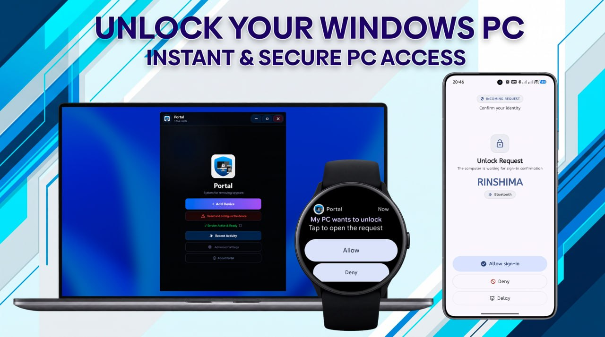
</p>

---

<p align="center">
  <a href="#about-en">💡 About</a> • 
  <a href="#matrix-en">📊 Comparison</a> • 
  <a href="#demo-en">🎬 Live Demo</a> • 
  <a href="#quick-en">🚀 Quick Start</a> • 
  <a href="#host-ui-en">🖥️ Portal.Host App</a> • 
  <a href="#logon-en">🪟 Windows 11 LogonUI</a> • 
  <a href="#play-screens-en">📱 Google Play Store</a> • 
  <a href="#wear-en">⌚ Wear OS Watch</a> • 
  <a href="#modes-en">🎛️ Unlock Modes</a> • 
  <a href="#channels-en">📡 Channels</a> • 
  <a href="#security-en">🛡️ Security</a> • 
  <a href="#features-en">🌟 Features</a> • 
  <a href="#troubleshoot-en">🧰 Troubleshooting</a> • 
  <a href="#arch-en">🧩 Architecture</a> • 
  <a href="#build-en">💻 Build from Source</a> • 
  <a href="#license-en">📄 License</a>
</p>

---

<a id="about-en"></a>
## 💡 About Portal-Windows

**Portal-Windows** is a high-performance **Windows Credential Provider V2** native module accompanied by a host desktop service (`Portal.Host` built on WPF and .NET 10). It turns your Android smartphone and Wear OS smartwatch into an encrypted, wireless biometric key for Windows.

Eliminate repetitive keyboard password entry whenever you turn on your PC, resume from sleep, or approve elevated administrator privileges:
- 👆 **Instant Mobile Biometrics:** Touch ID / Fingerprint sensor or Face Unlock on your smartphone.
- ⌚ **Wrist Approval:** High-priority haptic notification on Wear OS with an "Allow" tap right on your watch.
- 🔒 **100% P2P & Zero-Cloud:** Windows credentials remain securely encrypted inside the **Windows LSA Secret Store** and are **never transmitted across the network**.
- 🛡️ **Native UAC Elevation:** Approve User Account Control elevation dialogs effortlessly without typing administrator credentials.

---

<a id="matrix-en"></a>
## 📊 Feature Comparison Matrix

| Feature | Regular Password | Windows Hello (IR Cam/Dongle) | Cloud Solutions | **Portal-Windows** |
| :--- | :---: | :---: | :---: | :---: |
| **Typing Speed** | ❌ Slow typing | ⚡ Fast | ⚡ Fast | ⚡ **Instant (P2P)** |
| **PC Hardware Dependency** | ❌ Physical keyboard | ❌ Requires IR Cam / USB dongle | ❌ Cloud server uptime | ✅ **Any PC (Desktop / Laptop)** |
| **Offline Operation** | ✅ Yes | ✅ Yes | ❌ Requires internet | ✅ **Yes (LAN / Bluetooth)** |
| **Data Privacy** | ⚠️ Shoulder surfing | ✅ Local | ❌ Third-party servers | 🛡️ **Zero-Cloud, mTLS X.509** |
| **Smartwatch Support** | ❌ No | ❌ No | ⚠️ Rare | ⌚ **Wear OS (Out of the box)** |
| **Wake Sleeping PC** | ❌ No | ❌ No | ⚠️ Complex | ⚡ **Wake-on-LAN (Integrated)** |
| **UAC Dialog Integration** | ❌ Manual typing | ⚠️ Inconsistent | ❌ No | ✅ **Natively Supported** |

---

<a id="demo-en"></a>
## 🎬 Live Demonstrations

Real-time interactive progress bar right below the user tile on LogonUI, instant challenge notification on the phone, fingerprint match — and your desktop is unlocked:

<p align="center">
  
</p>

Seamless biometric authorization for **UAC** administrative elevation:

<p align="center">
  
</p>

---

<a id="quick-en"></a>
## 🚀 Quick Start in 60 Seconds

### System Requirements

| Component | Requirement |
| :--- | :--- |
| 🪟 **Operating System** | Windows 10 (1809+) or Windows 11, x64 architecture |
| ⚙️ **Runtime** | .NET 10.0 Desktop Runtime *(bundled in the release distribution)* |
| 📱 **Mobile Device** | Android 8.0+ smartphone with Fingerprint or Face Unlock |
| ⌚ **Smartwatch (Optional)** | Wear OS 3.0+ smartwatch |

### Installation Walkthrough

<p align="center">
  
</p>

1. **Install the mobile app** from [Google Play](https://play.google.com/store/apps/details?id=com.xxmrk888ytxx.portal) or download the APK from the [Android Repository Releases](https://github.com/xXMRK888YTXx/Portal-Android/releases).
2. **Download Portal-Windows** — grab `PortalWin-1.9.5-win-x64.zip` from [GitHub Releases](https://github.com/KoksMen/Portal-Windows/releases/latest).
3. **Extract to a permanent folder** (e.g., `C:\Program Files\Portal`) and run `Portal.Host.exe` **as Administrator**.
4. **Click "START"** — Portal registers the COM Credential Provider and configures local firewall rules.
5. **Pair in seconds:**
   - In Portal Host, navigate to **"Devices"** $\rightarrow$ **"+ Add Device"**.
   - In the Android app, tap **"+"** $\rightarrow$ select Wi-Fi or Bluetooth $\rightarrow$ scan the QR code on your monitor.
6. **All set!** Lock Windows with <kbd>Win</kbd> + <kbd>L</kbd> and touch your phone's fingerprint sensor. 🎉

---

<a id="host-ui-en"></a>
## 🖥️ Portal.Host Desktop Management Application

The host background service features an ergonomic **WPF** desktop application styled with Microsoft's **Fluent Design System**:

| 🖥️ Portal.Host Main Dashboard | 📡 Connection Protocol Selector |
| :---: | :---: |
| 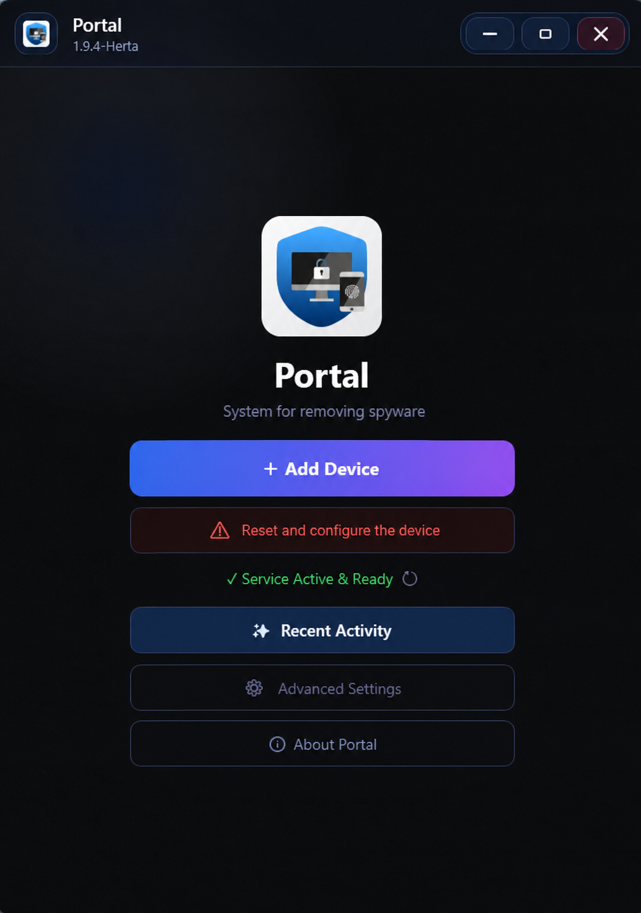 | 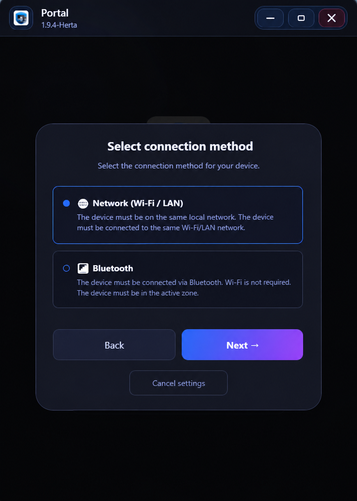 |
| *Service health monitor, paired devices list & activity history* | *Guided pairing wizard for local Wi-Fi or Bluetooth RFCOMM* |

---

<a id="logon-en"></a>
## 🪟 Windows 11 Lock Screen (LogonUI) Experience

The **Portal.CredentialProvider** COM in-process component injects directly into the Windows LogonUI subsystem:

<p align="center">
  
</p>

*Live telemetry indicators show dynamic countdown timers, Wi-Fi IP binding, and active Bluetooth radio channels right beneath the user tile.*

---

<a id="play-screens-en"></a>
## 📱 Official Google Play Store Showcase (EN)

| 📱 1. Manage Devices | 🛡️ 2. Security Configuration | ⚡ 3. Quick Shortcuts |
| :---: | :---: | :---: |
| 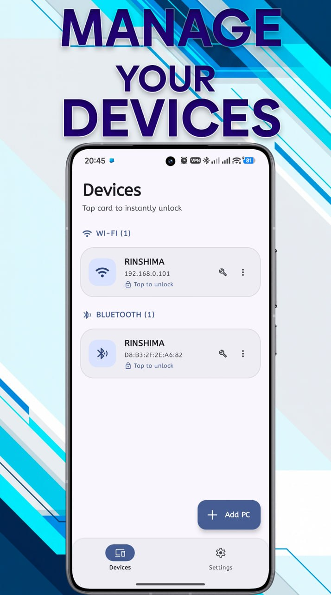 | 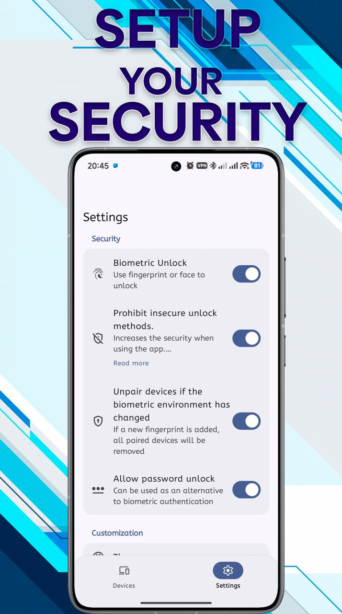 | 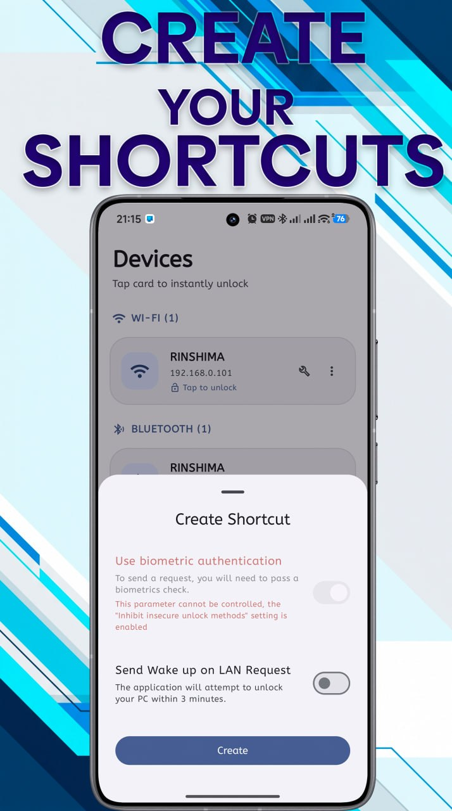 |
| *Paired devices with live connection status* | *Biometrics, lockout policy & unpair rules* | *Home screen widgets & WOL trigger* |

---

<a id="wear-en"></a>
## ⌚ Wear OS Smartwatch Companion App

The Wear OS companion app provides autonomous wrist control and incoming authorization prompts:

| ⌚ 1. Quick Status | 🔓 2. Instant Unlock | ⚙️ 3. Action Menu | ☕ 4. Wake-on-LAN |
| :---: | :---: | :---: | :---: |
|  |  |  |  |
| *Paired PC list on your wrist* | *One-tap unlock button* | *Connection mode selector* | *Remote WOL magic packet* |

- **"First Decision Wins":** Answering the notification on your watch immediately dismisses the prompt on your phone.
- **Zero-Cloud Privacy:** Password secrets never touch the watch; only short-lived cryptographic challenge nonces are exchanged.

---

<a id="modes-en"></a>
## 🎛️ 3 Convenient PC Unlock Modes

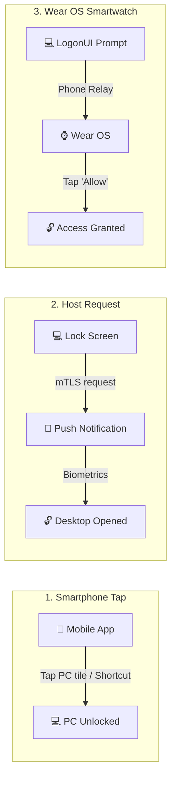

1. **Mode 1: Smartphone-Initiated (Client)** — approaching your workstation, tap your PC card or home screen shortcut on your smartphone; your PC unlocks immediately.
2. **Mode 2: Host-Initiated (Lock Screen)** — wake your computer or press a key. Windows sends an encrypted authorization ping to your paired device. Place your finger on the sensor to log in.
3. **Mode 3: Wear OS Smartwatch** — phone is in your bag or charging. Feel a gentle haptic vibration on your watch, tap "Allow", and your desktop is ready.

---

<a id="channels-en"></a>
## 📡 Connection Channels & Protocols

<p align="center">
  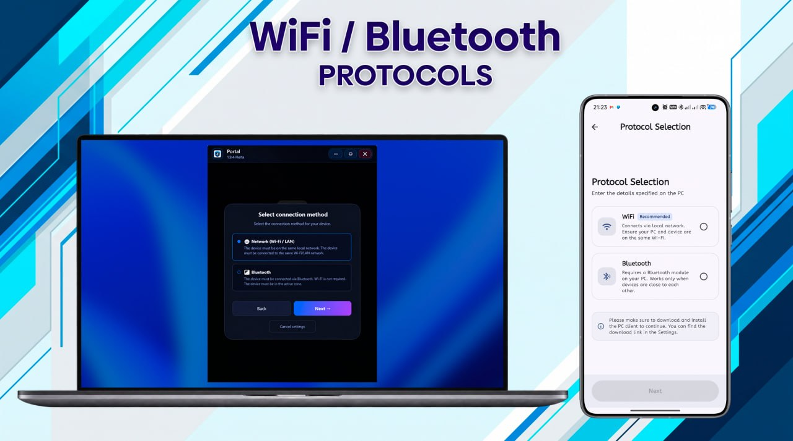
</p>

- **High-throughput mTLS WebSocket:** Sub-15ms round-trip latency over local Wi-Fi or Ethernet.
- **Direct Bluetooth RFCOMM:** Operates fully autonomously without needing a local Wi-Fi router or external network.
- **VPN Compatibility:** Built-in auto-detection ignores virtual interfaces (WireGuard, Wintun) during mDNS announcements, maintaining unbroken local connectivity.
- **Remote Wake-on-LAN:** Dispatches secure Wake-on-LAN magic packets to wake sleeping hardware before delivering the unlock payload.

---

<a id="security-en"></a>
## 🛡️ Security Architecture

<p align="center">
  
</p>

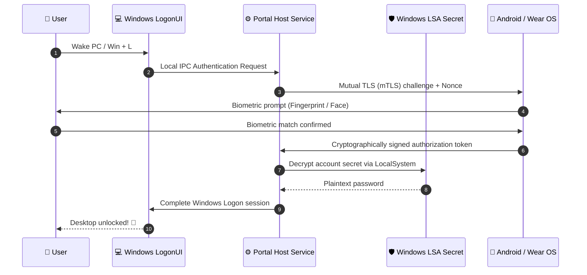

- 🔒 **Windows LSA Secret Store:** User credentials remain isolated inside the operating system's Local Security Authority (LSA). Only the privileged `LocalSystem` kernel identity can access the secret. No third-party processes can extract stored credentials.
- 🔐 **Mutual TLS (mTLS) Authentication:** Communication between Windows and mobile devices is strictly authenticated via bilateral X.509 certificates with SHA-256 fingerprint validation, completely mitigating Man-in-the-Middle (MitM) exploits.
- 🛡️ **Zero-Knowledge & Zero-Cloud:** No intermediary servers, external telemetry, or cloud relays. Traffic is contained strictly within your local LAN or direct Bluetooth RFCOMM channels.
- 🎯 **Replay-Attack Protection:** Every transaction generates a unique cryptographic `RequestId` combined with strict time-to-live timestamps (Nonces).
- 🔑 **Optional 2FA PIN:** For high-security environments, combine mobile biometrics with a mandatory physical keyboard PIN on the PC featuring a 3-attempt brute-force lockout.

---

<a id="features-en"></a>
## 🌟 Advanced Features & Capabilities

<details>
<summary><b>⏳ 1. Customizable Dynamic Progress Bar</b></summary>

- Interactive progress countdown rendered directly under the user tile in LogonUI.
- 3 visual styling options: Block `[████]`, Line `[━━━━]`, and Dot `[●●●●]`.
- Smooth marquee wave animation for infinite wait modes.

</details>

<details>
<summary><b>💾 2. Encrypted Profile Backups (.portalbackup)</b></summary>

- Export and import configurations, paired devices, and TLS certificates securely using **AES-256-GCM** encryption with PBKDF2 password derivation (210,000 iterations).

</details>

<details>
<summary><b>🛡️ 3. Self-Repairing Firewall Integration</b></summary>

- Automated health-checks detect and restore necessary Windows Defender Firewall inbound rules (TCP 51234 for mTLS, UDP 5353 for mDNS) if altered by third-party security software.

</details>

<details>
<summary><b>⚡ 4. Remote Wake-on-LAN (WOL)</b></summary>

- If your workstation is hibernating or asleep, Portal dispatches a secure Wake-on-LAN magic packet to wake the hardware before delivering the unlock payload.

</details>

---

<a id="troubleshoot-en"></a>
## 🧰 Troubleshooting

<p align="center">
  
</p>

- **Mobile app cannot locate the PC:**
  1. Confirm both the PC and smartphone are connected to the same Wi-Fi subnet (or enable Bluetooth).
  2. Verify that Windows Network Profile is set to **"Private"** (Public profiles block local inbound discovery).
  3. Click **"⚡ Test Connection"** within the device card in Portal Host.
- **Exporting Diagnostic Logs:**
  - Inside Portal Host, navigate to Settings and click **"Export Diagnostic Logs"**. The service generates a `portal-diagnostics-*.zip` bundle ready for [GitHub Issue submission](https://github.com/KoksMen/Portal-Windows/issues).

---

<a id="arch-en"></a>
## 🧩 Portal-Windows Solution Architecture

<p align="center">
  
</p>

```text
┌────────────────────────────────────────────────────────────────────────┐
│                        Portal-Windows Solution                         │
├──────────────────────────┬─────────────────────────────────────────────┤
│ 🖥️ Portal.Host           │ Desktop WPF application (Fluent UI, device  │
│                          │ management, 2FA PIN, LSA credential audit)  │
├──────────────────────────┼─────────────────────────────────────────────┤
│ 🔑 Portal.Credential     │ Native COM Provider V2 integrated into the  │
│    Provider              │ Windows sign-in screen (LogonUI) & UAC      │
├──────────────────────────┼─────────────────────────────────────────────┤
│ 🔄 Portal.Updater        │ Secure background update engine with        │
│                          │ Authenticode digital signature validation   │
├──────────────────────────┼─────────────────────────────────────────────┤
│ 📦 Portal.Common         │ Shared crypto libraries, networking models, │
│                          │ rate-limiting protocols and mDNS discovery  │
└──────────────────────────┴─────────────────────────────────────────────┘
```

---

<a id="build-en"></a>
## 💻 Building from Source

To compile Portal-Windows locally:
- **Visual Studio 2022** (17.12+) or **JetBrains Rider** with **.NET 10.0 SDK**.
- **.NET Desktop Development** workload (WPF / C# 13).
- PowerShell 7+ or Windows PowerShell 5.1.

```powershell
# 1. Clone repository
git clone https://github.com/KoksMen/Portal-Windows.git
cd Portal-Windows

# 2. Restore dependencies
dotnet restore Portal-Windows.slnx

# 3. Build in Release mode
dotnet build Portal-Windows.slnx -c Release

# 4. Package standalone distribution
powershell -ExecutionPolicy Bypass -File scripts/package-release.ps1
```

---

<a id="license-en"></a>
## 📄 License & Community

Portal is distributed under the terms of the **GNU General Public License v3.0** — see [LICENSE.txt](LICENSE.txt) for details.

- **Windows Architecture & Core:** [@KoksMen](https://github.com/KoksMen)
- **Android & Wear OS Lead:** [@xXMRK888YTXx](https://github.com/xXMRK888YTXx)
- **Android Repository:** [xXMRK888YTXx/Portal-Android](https://github.com/xXMRK888YTXx/Portal-Android)
- Special thanks to **WPF-UI**, **QRCoder**, and **Makaretu.Dns** for their excellent open-source foundations.

---

<p align="center">
  <a href="#russian"><b>↑ Наверх к русской версии (Top RU)</b></a> • 
  <a href="#top"><b>🔝 В самое начало (Top)</b></a> • 
  <a href="#english"><b>↑ Top of English Version</b></a>
</p>
