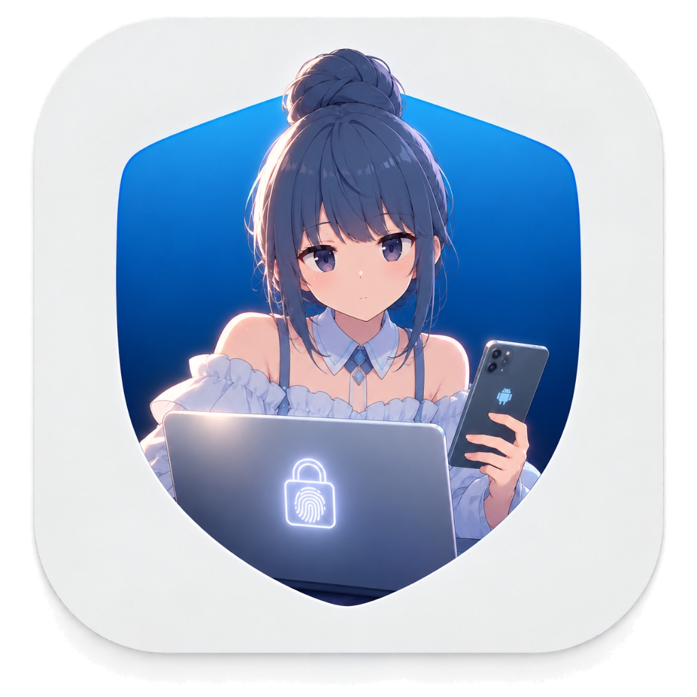

<p align="center">
  
</p>

<h1 align="center">✨ Portal-Windows ✨</h1>
<h3 align="center">🔮 Кодовое имя: <em>Herta</em> (v1.9.2) 🪄</h3>

<p align="center">
  <b>Бесшовная, безопасная и мгновенная разблокировка Windows с помощью вашего смартфона или умных часов</b><br>
  <i>Seamless, secure, and instantaneous Windows unlocking using your smartphone or smartwatch</i>
</p>

<p align="center">
  <a href="https://github.com/KoksMen/Portal-Windows/releases"></a>
  
  
  <a href="https://play.google.com/store/apps/details?id=com.xxmrk888ytxx.portal"></a>
  <a href="LICENSE.txt"></a>
</p>

<p align="center">
  <a href="#-portal-windows-на-русском"><b>🇷🇺 Перейти к русской версии</b></a> •
  <a href="#-portal-windows-in-english"><b>🇬🇧 Switch to English Version</b></a>
</p>

<p align="center">
  <a href="https://github.com/KoksMen/Portal-Windows/releases/latest">
    
  </a>
  <a href="https://play.google.com/store/apps/details?id=com.xxmrk888ytxx.portal">
    
  </a>
  <a href="https://github.com/xXMRK888YTXx/Portal-Android">
    
  </a>
</p>

---

# 🇷🇺 Portal-Windows (На русском)

## 💡 О проекте

**Portal-Windows** — это передовая экосистема биометрической аутентификации Windows (кастомный **Windows Credential Provider V2**), позволяющая мгновенно, безопасно и удобно разблокировать компьютер или ноутбук с помощью вашего смартфона или смарт-часов.

Забудьте о рутинном наборе длинных сложных паролей на клавиатуре каждый раз при включении ПК или выходе из спящего режима. Достаточно коснуться сканера отпечатка пальца на смартфоне или подтвердить действие на смарт-часах — и рабочий стол Windows моментально разблокируется! 🚀

> [!TIP]
> Система поддерживает не только локальный экран блокировки при входе в Windows, но и диалоговые окна **UAC (Контроль учетных записей)** для запуска приложений от имени администратора без ручного ввода пароля.

---

## 📱 Мобильное приложение (Mobile App)

Для работы с системой используется мобильное приложение-клиент **Portal**:

| Канал загрузки | Ссылка | Описание |
| :--- | :--- | :--- |
| 🟢 **Google Play Store** | [**Установить из Google Play**](https://play.google.com/store/apps/details?id=com.xxmrk888ytxx.portal) | Официальный проверенный клиент для Android |
| 🐙 **GitHub (Android Client)** | [**xXMRK888YTXx/Portal-Android**](https://github.com/xXMRK888YTXx/Portal-Android) | Исходный код мобильного клиента и APK-файлы |
| ⌚ **Поддержка Wear OS** | Встроена в мобильный клиент | Разблокировка компьютера прямо с вашего запястья! |

### Возможности мобильного клиента:
- 👆 **Биометрия:** Поддержка отпечатка пальца (Touch ID / Fingerprint) и распознавания лица (Face Unlock).
- 📲 **Мгновенный отклик (Direct Socket / Push):** Всплывающее окно запроса разблокировки появляется на экране за доли секунды.
- 🧩 **Шторка быстрых настроек:** Быстрая плитка (Quick Settings Tile) в Android для входа без открытия приложения.
- ⌚ **Часы Wear OS:** Мгновенное подтверждение входа прямо с часов.
- 🔐 **Аппаратное хранение ключей:** Приватные ключи и сертификаты надежно защищены модулем Android KeyStore.

---

## 🌟 Возможности и функционал системы

### 🔐 1. Двухфакторная аутентификация по PIN-коду (2FA PIN) и сессионный льготный период
- **Сценарий двухфакторного входа:** Подтверждение биометрией на доверенном смартфоне $\rightarrow$ ввод персонального PIN-кода на физической клавиатуре компьютера $\rightarrow$ вход в Windows.
- **Криптографическая защита:** Хеширование **PBKDF2-SHA256** (100 000 итераций) с индивидуальной 16-байтовой криптографической солью (`RNGCryptoServiceProvider`) для каждой учетной записи.
- **Аппаратная защита от подбора (Brute-Force Guard):** Жесткий лимит на **3 неверные попытки ввода PIN**. При превышении лимита сессия немедленно аннулируется, сокеты закрываются, а на экране блокировки выводится защитное сообщение.
- **Временное отключение 2FA PIN (Session Grace Period):** Настраиваемый интервал сессии (1м, 2м, 5м, 10м, 15м, 30м, 1ч, 2ч или произвольное число минут). Если компьютер блокируется и разблокируется в пределах этого окна, повторный ввод PIN не требуется — вход происходит мгновенно по биометрии.
- **Абсолютная безопасность сессии:**
  - Привязка к аппаратному монотонному аптайму (`Environment.TickCount64`) — исключена уязвимость с переводом системных часов Windows.
  - Мгновенное аннулирование сессии при перезагрузке ОС или выключении питания.
  - Немедленный сброс и очистка сессии при любой ошибке аутентификации.
  - Строгая изоляция сессий между разными учетными записями и устройствами.
- **Настройка в Host:** Интерактивный статус-бейдж `[2FA PIN]` на карточке устройства, гибкие пресеты интервалов и модальный диалог управления PIN-кодом с маскировкой ввода и валидацией длины (от 4 до 30 знаков).

### ⏳ 2. Живой динамический прогресс-бар и стили экрана входа
- **Интерактивный таймер на плитке пользователя:** Прямо под аватаром отображается стильная шкала тайм-аута и таймер обратного отсчёта.
- **3 визуальных стиля шкалы:** Блочный `[████]`, тонкий `[━━━━]` и точечный `[●●●●]` — настраиваются в один клик в параметрах приложения Host.
- **Идеальное нативное центрирование:** Статусный заголовок и полоса прогресса разнесены по отдельным системным контролам LogonUI — текст всегда строго выровнен по центру контейнера плитки без смещений.
- **Адаптивная геометрическая калибровка:** Длина шкалы рассчитывается строго по первой строке текста под контейнер DirectUI (~305 px), гарантируя отсутствие обрезания символов.
- **Защита от переноса строк (No-Wrap):** Пробелы вокруг бейджей времени заменены на неразрывные (`\u00A0`), что исключает разрыв строки компонентами Windows.
- **Симметричный режим ожидания:** В бесконечном режиме выводится плавная бегущая волна (marquee) и симметричные бейджи бесконечности:
  ```text
  [█████████  1:44  ██████▒░░░]  <- Режим с тайм-аутом (динамическое центрирование)
  [██░░░░  (∞) 0:15 (∞)  ░░░░██]  <- Бесконечный режим (симметричный marquee)
  ```

### 📺 3. Умные статусы плитки и разделение состояний
- **Четкое разделение фаз:** Во время ожидания подтверждения на телефоне на экране блокировки отображается статус `«Ожидание подтверждения»`. Статус `«Введите 2FA PIN»` активируется **только** после успешного биометрического одобрения на смартфоне.
- **Подавление ложной отмены (Manual Typing Suppression):** Ввод символов PIN-кода с клавиатуры не вызывает ложную отмену сессии `«Вход отменен из-за ввода пароля вручную»`. Авто-отмена срабатывает исключительно при вводе в поле основного пароля Windows.
- **Расшифровка ошибок Windows (NTSTATUS OnLogonStatusReported):** Плитка перехватывает системные коды Winlogon и выводит понятную причину: «Неверный пароль Windows» `[🔑]`, «Учётная запись заблокирована» `[🔒]`, «Срок действия пароля истёк» `[⌛]`, «Учётная запись отключена» `[🚫]`.

### 🆔 4. Привязка устройств по SID (SID-First Identity) и политики учетных записей
- **Криптографическая привязка к SID:** Идентификаторы сопряженных устройств связываются с уникальным Security Identifier (SID) учетной записи Windows (`Win32_UserProfile` / `LookupAccountName`).
- **Поддержка любых типов аккаунтов:** Полная совместимость с локальными пользователями, учетными записями Microsoft (MSA, `user@outlook.com`) и корпоративными доменными учетными записями Active Directory (UPN).
- **Индивидуальные режимы разблокировки:** Настройка режима входа для каждого аккаунта (`BiometricOnly`, `BiometricOrPin`, `PinOnly`).
- **Срок действия сессии:** Конфигурируемое время бездействия учетной записи с автоматическим сбросом.

### 🛡️ 5. Двухуровневый Rate Limiting и защита от DoS
- **Фильтрация по IP и сертификату:** Защита сетевых портов и WebSocket от атак отказа в обслуживании (DoS) и попыток брутфорса на основе IP-адреса и отпечатка клиентского TLS-сертификата.
- **Ограничение памяти (Memory Cap):** Скользящие окна с автоматической очисткой устаревших сессий и защитой от переполнения оперативной памяти.

### 📡 6. Двойной канал связи (Wi-Fi/LAN + Bluetooth)
- 🚀 **Локальный mTLS WebSocket:** Высокоскоростной обмен пакетами по Wi-Fi / Ethernet с минимальной задержкой (RTT < 15 мс).
- 📶 **Прямой Bluetooth RFCOMM канал:** Работает автономно при отключенном роутере, отсутствии Wi-Fi или сбоях интернета.
- 📊 **Живой индикатор транспорта:** В подробностях плитки выводится активный транспорт и локальный IP-адрес (`Wi-Fi: Активен (192.168.1.5)` / `Bluetooth: Подключён (1)`).

### 🔍 7. Автоматическое обнаружение сети (Zero-Config mDNS)
- Компьютер автоматически объявляет о себе в локальной сети по протоколу mDNS (`_portal._tcp.local.`).
- Мобильное приложение находит ПК моментально без ручного ввода IP-адресов или настройки портов.

### 🌐 8. Динамическая сетевая адаптация (NetworkChange)
- Служба отслеживает системные события `System.Net.NetworkInformation.NetworkChange`.
- При переключении между Wi-Fi сетями, точками доступа, проводным Ethernet или VPN слушатели обновляются автоматически, а mDNS-сервис плавно перезапускается.

### 🪟 9. Эргономичный интерфейс управления (Fluent Design)
- **Современный UI в стиле Windows 11:** Эффекты размытия Mica Alt & Acrylic, мягкие скругления, динамическая смена светлой и тёмной темы.
- **Живая LSA-валидация паролей:** При запуске приложения и отображении карточек устройств выполняется проверка сохраненного пароля через нативный системный вызов `LogonUserW` с бейджами `[✓ Пароль верен]` или `[✕ Неверный пароль]`.
- **Интерактивная диагностика:** Кнопка **«⚡ Проверить связь»** для измерения реальной задержки сети (RTT в миллисекундах) с подключенным телефоном.
- **Экспорт отчёта диагностики в один клик:** Формирование единого ZIP-архива `portal-diagnostics-*.zip` со всеми логами и параметрами для быстрого решения технических вопросов.

### 🛡️ 10. Аудит и самовосстановление правил брандмауэра (Self-Repair Firewall)
- Фоновый мониторинг входящих правил Windows Defender Firewall (TCP 51234 для mTLS и UDP 5353 для mDNS).
- Автоматическое восстановление правил при их случайном удалении сторонними антивирусами.

### 🔍 11. Поиск и умная фильтрация журналов
- Окно журналов `LogsWindow` оснащено строкой поиска и быстрыми фильтрами: **«Все»**, **«Ошибки»**, **«Сеть (WS)»**, **«Bluetooth (BLE)»**.
- Высокопроизводительная фильтрация в памяти без лагов дискового ввода-вывода.

### ⌨️ 12. Мгновенная клавиатурная навигация
- **Повтор запроса по Enter:** Нажатие <kbd>Enter</kbd> на плитке при пустом поле пароля моментально отправляет удалённый запрос на телефон без использования мыши.
- **Fail-Safe Typing Rollback:** Если пользователь начинает вводить основной пароль Windows на клавиатуре, удалённый запрос мгновенно отменяется, а фокус возвращается в поле пароля без потери первого введенного символа.

### 💾 13. Защищённое резервное копирование (.portalbackup)
- Экспорт и импорт полного профиля (настройки, устройства, сертификат хоста) в зашифрованный контейнер по алгоритму AES-256-GCM с PBKDF2 (210 000 итераций) и защитой мастер-паролем.

---

## 🛡️ Архитектура безопасности (Security Architecture)

Безопасность персональных данных и корпоративная надежность — фундаментальный приоритет архитектуры Portal:

- 🔒 **Изоляция учетных данных в Windows LSA:** Учетные данные пользователя **никогда не хранятся** в конфигурационных файлах, открытом тексте или реестре. Используется системное хранилище **Windows Local Security Authority (LSA) Secret Store**, доступ к которому имеет исключительно процесс ядра операционной системы (`LocalSystem`).
- 🔐 **Взаимная аутентификация mTLS:** Все сетевые соединения защищены TLS с валидацией отпечатков сертификатов как на стороне ПК, так и на стороне смартфона.
- 🎯 **Защита от Replay-атак (Strict RequestId Matching):** Сессионные токены жестко привязаны к коротким сессионным идентификаторам, исключая повторное воспроизведение перехваченных пакетов.
- 🤝 **Криптографическое сопряжение (Pairing Context):** Разблокировать систему может только то мобильное устройство, которое прошло авторизацию через защищённый QR-код.
- ⚡ **Zero-Allocation Protocol & Async Logger:** Неблокирующая асинхронная запись логов через каналы `System.Threading.Channels` и разбор сетевых пакетов на основе `ReadOnlySpan<byte>` без промежуточных аллокаций памяти.
- 🚀 **ReadyToRun (AOT) компиляция:** Модуль `Portal.CredentialProvider` скомпилирован в машинный код ReadyToRun, исключая задержки JIT-компиляции при отображении экрана входа Windows.
- ✍️ **Цифровая подпись Authenticode:** Все бинарные файлы подписаны сертификатами Authenticode с RFC 3161 метками времени Microsoft TSA SHA-256. Релизный архив снабжен контрольной суммой SHA-256 (`.sha256`) и отсоединенной цифровой подписью PKCS#7 / CMS (`.sig`).

---

## 🧩 Компоненты решения

```
┌────────────────────────────────────────────────────────────────────────┐
│                             Portal Solution                            │
├──────────────────────────┬─────────────────────────────────────────────┤
│ 🖥️ Portal.Host           │ Десктопное приложение WPF (Fluent UI,       │
│                          │ управление устройствами, 2FA PIN, аудит LSA)│
├──────────────────────────┼─────────────────────────────────────────────┤
│ 🔑 Portal.Credential     │ Системный COM-провайдер V2 для интеграции   │
│    Provider              │ в экран входа Windows (LogonUI) и диалог UAC│
├──────────────────────────┼─────────────────────────────────────────────┤
│ 🔄 Portal.Updater        │ Модуль безопасного фонового обновления      │
│                          │ с проверкой цифровой подписи Authenticode   │
├──────────────────────────┼─────────────────────────────────────────────┤
│ 📦 Portal.Common         │ Общая библиотека криптографии, протоколов,  │
│                          │ Rate Limiting, mDNS и моделей данных        │
└──────────────────────────┴─────────────────────────────────────────────┘
```

---

## 🛠️ Установка и быстрый старт

### Требования к системе:
- **ОС:** Windows 10 (версия 1809+) или Windows 11 (любая редакция, x64).
- **Среда выполнения:** .NET 10.0 Desktop Runtime (включена в дистрибутив).
- **Смартфон:** Android 8.0+ с камерой и биометрическим сканером.

---

### Пошаговая инструкция:

1. **Установите мобильное приложение:**
   - Скачайте клиент из [**Google Play**](https://play.google.com/store/apps/details?id=com.xxmrk888ytxx.portal) или установите APK из [репозитория Android](https://github.com/xXMRK888YTXx/Portal-Android/releases).
198: 2. **Скачайте Portal-Windows:**
199:    - Перейдите в раздел [**Releases**](https://github.com/KoksMen/Portal-Windows/releases/latest) и скачайте архив `PortalWin-1.9.2-win-x64.zip`.
200: 3. **Распакуйте и запустите:**
201:    - Распакуйте архив в постоянный каталог (например, `C:\Program Files\Portal` или в каталог профиля пользователя).
202:    - Запустите файл `Portal.Host.exe` от имени администратора.
203: 4. **Активируйте службу:**
204:    - В открывшемся главном окне нажмите большую кнопку **«СТАРТ»**.
205:    - Приложение автоматически настроит правила брандмауэра и зарегистрирует COM-библиотеку провайдера.
206: 5. **Подключите смартфон:**
207:    - Перейдите на вкладку **Устройства** и нажмите **«+ Добавить устройство»**.
208:    - На экране появится защищённый одноразовый QR-код.
209:    - Откройте приложение Portal на смартфоне, нажмите **«Сканировать QR-код»** и наведите камеру на монитор.
210:    - Задайте имя компьютеру — сопряжение завершено! 🎉
211: 6. **(Опционально) Настройте 2FA PIN:**
212:    - В меню карточки устройства нажмите **«Настроить 2FA PIN»** и задайте PIN-код для двухфакторной аутентификации.
213: 7. **Попробуйте в действии:**
214:    - Заблокируйте Windows комбинацией клавиш <kbd>Win</kbd> + <kbd>L</kbd>.
215:    - Вы увидите плитку Portal с живым прогресс-баром ожидания.
216:    - Подтвердите вход на смартфоне (и введите 2FA PIN при необходимости) — компьютер мгновенно разблокирован! 🪄✨
217: 
218: ---
219: 
220: ## 💻 Сборка из исходников
221: 
222: Для самостоятельной сборки решения:
223: - **Visual Studio 2022** (версия 17.12+) / **JetBrains Rider** / **.NET 10 SDK**.
224: - Рабочая нагрузка **.NET Desktop Development** (WPF).
225: - PowerShell 7+ или Windows PowerShell 5.1.
226: 
227: ### Шаги сборки:
228: 
229: ```powershell
230: # 1. Клонирование репозитория
231: git clone https://github.com/KoksMen/Portal-Windows.git
232: cd Portal-Windows
233: 
234: # 2. Восстановление зависимостей
235: dotnet restore Portal-Windows.slnx
236: 
237: # 3. Сборка решения в конфигурации Release
238: dotnet build Portal-Windows.slnx -c Release
239: 
240: # 4. Сборка чистого релизного пакета с подписью
241: powershell -ExecutionPolicy Bypass -File scripts/package-release.ps1
242: ```
243: 
244: Готовые файлы дистрибутива будут собраны в каталоге `dist/`, а готовый архив — в корне репозитория (`PortalWin-1.9.2-win-x64.zip`).

---

<br>

---

# 🇬🇧 Portal-Windows (In English)

## 💡 About the Project

**Portal-Windows** is a modern biometric authentication ecosystem for Windows (custom **Windows Credential Provider V2**), designed to effortlessly, securely, and instantaneously unlock your PC or laptop using your trusted smartphone or smartwatch.

No more typing long, complex master passwords on your physical keyboard multiple times a day. Simply touch the fingerprint sensor on your phone or tap your smartwatch screen, and your Windows desktop unlocks in a flash! 🚀

> [!TIP]
> The system seamlessly handles both standard Windows lock screens and elevated **User Account Control (UAC)** prompts, allowing you to approve administrator privileges right from your mobile device without typing your password.

---

## 📱 Mobile App

To pair and unlock your PC, install the companion **Portal** mobile client:

| Source | Link | Description |
| :--- | :--- | :--- |
| 🟢 **Google Play Store** | [**Get it on Google Play**](https://play.google.com/store/apps/details?id=com.xxmrk888ytxx.portal) | Official production client for Android |
| 🐙 **GitHub (Android Source)** | [**xXMRK888YTXx/Portal-Android**](https://github.com/xXMRK888YTXx/Portal-Android) | Original mobile client repository & APK downloads |
| ⌚ **Wear OS Support** | Included in mobile app | Unlock your desktop straight from your wrist! |

### Mobile Client Highlights:
- 👆 **Biometric Authentication:** Support for fingerprint (Touch ID) and facial recognition (Face Unlock).
- 📲 **Instant Push / Direct Socket:** Immediate unlock prompt popup with ultra-low latency.
- 🧩 **Quick Settings Tile:** Unlock directly from the Android quick settings shade.
- ⌚ **Wear OS Watches:** Approve PC unlock requests directly on your smartwatch.
- 🔐 **Hardware-Backed Security:** Cryptographic private keys and certificates are safeguarded by Android KeyStore.

---

## 🌟 Key Features & Capabilities

### 🔐 1. Two-Factor PIN Authentication (2FA PIN) & Session Grace Period
- **Two-Factor Authentication Flow:** Biometric approval on trusted phone $\rightarrow$ custom PIN input on Windows keyboard $\rightarrow$ Windows logon completed.
- **Cryptographic Security:** High-grade **PBKDF2-SHA256** hashing (100,000 iterations) with a unique 16-byte random salt per account (`RNGCryptoServiceProvider`).
- **Brute-Force Guard:** Strict lockout after **3 consecutive failed PIN attempts**. Upon lockout, the session is cleared, sockets close, and a security warning appears on the lock screen.
- **2FA Session Grace Period:** Configurable session window (1m, 2m, 5m, 10m, 15m, 30m, 1h, 2h, or arbitrary custom minutes). If Windows is locked and unlocked within this grace period, subsequent unlocks bypass the 2FA PIN prompt and complete instantly via biometrics.
- **Tamper-Proof Session Security:**
  - Based on hardware monotonic system uptime (`Environment.TickCount64`) — immune to Windows system clock tampering.
  - Instant session invalidation upon system reboot or shutdown.
  - Immediate purge on failed PIN attempt or invalid authentication.
  - Strict account isolation per device and Security Identifier (SID).
- **Host Settings Integration:** Dedicated `[2FA PIN]` status badge on device cards, flexible grace presets, and a setup dialog with input masking and length validation (4 to 30 characters).

### ⏳ 2. Live Lock Screen Progress Bar & Visual Styles
- **Real-Time LogonUI Progress Bar:** Sleek timeout progress bar and countdown timer embedded directly into the Windows user tile.
- **3 Visual Styles:** Block `[████]`, Thin `[━━━━]`, and Dots `[●●●●]`, configurable in one click in Host Settings.
- **Dead-Center Native Alignment:** Decoupled status headline and progress bar into dedicated LogonUI controls, guaranteeing pixel-perfect native DirectUI centering.
- **Adaptive Font Geometry:** Bar length calculates strictly based on the first text line and fits the DirectUI container limit (~305 px) to prevent clipping.
- **Line-Wrap Protection (No-Wrap):** Non-breaking spaces (`\u00A0`) prevent Windows DirectUI from splitting the bar across lines.
- **Symmetric Infinite Mode:** Displays a smooth ambient marquee wave with symmetric infinity badges when timeout is disabled:
  ```text
  [█████████  1:44  ██████▒░░░]  <- Countdown mode (centered dynamic fill)
  [██░░░░  (∞) 0:15 (∞)  ░░░░██]  <- Infinite mode (symmetric marquee)
  ```

### 📺 3. Smart Tile Statuses & Distinct States
- **Separated Status Flow:** Displays `"Awaiting approval"` while the mobile request is active. The prompt `"Enter 2FA PIN"` activates strictly after mobile approval.
- **Manual Typing Suppression:** Typing digits into the 2FA PIN field will not trigger a false-positive `"Manual password input"` cancellation. Auto-cancel is triggered strictly by keystrokes in the main Windows password box.
- **Windows Failure Reason Diagnostics (NTSTATUS OnLogonStatusReported):** Catches Winlogon failure codes and shows human-friendly reasons: "Wrong Windows Password" `[🔑]`, "Account Locked Out" `[🔒]`, "Password Expired" `[⌛]`, "Account Disabled" `[🚫]`.

### 🆔 4. SID-First Identity Resolution & Account Policies
- **User SID Binding:** Paired devices are cryptographically bound to the Windows user's Security Identifier (`Win32_UserProfile` / `LookupAccountName`).
- **Universal Account Compatibility:** Full support for local accounts, Microsoft Accounts (MSA, `user@outlook.com`), and domain Active Directory UPNs.
- **Per-Account Unlock Modes:** Configure unlock preferences per account (`BiometricOnly`, `BiometricOrPin`, `PinOnly`).
- **Inactivity Expiration:** Configurable inactivity expiration for sessions.

### 🛡️ 5. Dual-Layer Rate Limiting & DoS Protection
- **IP & TLS Certificate Throttling:** Protects unlock endpoints and WebSockets from denial-of-service (DoS) and brute-force attacks by tracking client IP and TLS certificate thumbprints.
- **Memory Cap:** Sliding time windows with an automated memory cap preventing memory exhaustion.

### 📡 6. Dual-Channel Connectivity (Wi-Fi/LAN + Bluetooth)
- 🚀 **High-Speed mTLS WebSocket:** Lightning-fast local network packet transfer with sub-15ms round-trip latency.
- 📶 **Direct Bluetooth RFCOMM:** Direct duplex Bluetooth channel operates autonomously even when routers or Internet access are offline.
- 📊 **Live Transport Indicator:** Tile details view shows active transport interface and local IP address (`Wi-Fi: Active (192.168.1.5)` / `Bluetooth: Connected (1)`).

### 🔍 7. Zero-Configuration mDNS Discovery
- Automatic local network computer announcement using multicast DNS (`_portal._tcp.local.`).
- Smartphone discovers your PC automatically without requiring static IP configuration.

### 🌐 8. Dynamic Network Adaptation (NetworkChange)
- Powered by `System.Net.NetworkInformation.NetworkChange`.
- Smoothly switches active listeners and debounces mDNS re-advertisement when moving between Wi-Fi networks, mobile hotspots, Ethernet, or VPNs.

### 🪟 9. Ergonomic Fluent UI Management
- **Modern Windows 11 Design:** Mica Alt & Acrylic backdrops, smooth corner radiuses, and dynamic dark/light theme switching.
- **Live LSA Password Validation:** Background audit via native `LogonUserW` verifies saved passwords on startup, showing `[✓ Password valid]` or `[✕ Invalid password]` badges.
- **Interactive Diagnostics:** **«⚡ Check Connection»** button pings mobile devices and measures real-time Round-Trip Time (RTT latency in milliseconds).
- **One-Click Diagnostic ZIP Export:** Bundles host logs, provider logs, network interfaces, and environment telemetry into `portal-diagnostics-*.zip`.

### 🛡️ 10. Windows Defender Firewall Self-Repair
- Background watchdog checks inbound rules for Windows Defender Firewall (TCP 51234 for mTLS and UDP 5353 for mDNS).
- Missing or purged firewall rules are automatically restored without interrupting the user.

### 🔍 11. Search & Fast Filtering in Logs
- Dedicated search box and category chip filters: **"All"**, **"Errors"**, **"Network (WS)"**, **"Bluetooth (BLE)"**.
- Instant in-memory search across logs without disk latency.

### ⌨️ 12. Instant Keyboard Controls
- **Retry on Enter:** Pressing <kbd>Enter</kbd> on an idle tile with an empty password field triggers an immediate remote unlock request without touching the mouse.
- **Fail-Safe Typing Rollback:** Typing a password on the keyboard immediately cancels pending remote requests and smoothly returns input focus to the password box without dropping the first character.

### 💾 13. Secure Encrypted Backups (.portalbackup)
- Export and import your entire profile (settings, paired devices, and host TLS certificate) in an AES-256-GCM encrypted package with PBKDF2 key derivation (210,000 iterations) and master password protection.

---

## 🛡️ Enterprise-Grade Security Architecture

- 🔒 **Zero Plaintext Credentials in Storage:** Passwords are **never** stored in config files, plain text, or registry. Secure **Windows LSA (Local Security Authority) Secret Store** is used exclusively, accessible only by the Windows kernel `LocalSystem` process.
- 🔐 **Mutual TLS (mTLS):** All network communications are encrypted with TLS 1.3/1.2 requiring mutual certificate validation.
- 🎯 **Strict RequestId Anti-Replay Validation:** Unlock tokens are bound to cryptographic, short-lived session request identifiers, preventing replay attacks.
- 🤝 **Pairing Cryptography:** Only explicitly paired devices possessing valid pairing context certificates can authorize unlock requests.
- ⚡ **Zero-Allocation Protocol & Async Logger:** High-throughput channel-based async logging via `System.Threading.Channels` and zero-allocation span-based packet parsing on `ReadOnlySpan<byte>`.
- 🚀 **ReadyToRun (AOT) Precompilation:** The `Portal.CredentialProvider` COM assembly is pre-compiled via ReadyToRun (AOT), avoiding JIT pauses when rendering the Windows logon screen.
- ✍️ **Signed Releases:** All binaries are signed with Authenticode with Microsoft TSA RFC 3161 timestamps. Release packages include SHA-256 checksums (`.sha256`) and detached PKCS#7 signatures (`.sig`).

---

## 🧩 Solution Architecture

```
┌────────────────────────────────────────────────────────────────────────┐
│                             Portal Solution                            │
├──────────────────────────┬─────────────────────────────────────────────┤
│ 🖥️ Portal.Host           │ Desktop WPF application (Fluent UI, device  │
│                          │ management, 2FA PIN, LSA secret audit)      │
├──────────────────────────┼─────────────────────────────────────────────┤
│ 🔑 Portal.Credential     │ Native Windows COM V2 Credential Provider   │
│    Provider              │ embedded into LogonUI.exe and CredUI        │
├──────────────────────────┼─────────────────────────────────────────────┤
│ 🔄 Portal.Updater        │ Secure background updater with              │
│                          │ Authenticode digital signature validation   │
├──────────────────────────┼─────────────────────────────────────────────┤
│ 📦 Portal.Common         │ Shared cryptography, rate limiting, mDNS,   │
│                          │ protocols, and data contracts               │
└──────────────────────────┴─────────────────────────────────────────────┘
```

---

## 🛠️ Quick Start Guide

### Prerequisites:
- **Operating System:** Windows 10 (1809+) or Windows 11 (all editions, x64).
- **Runtime:** .NET 10.0 Desktop Runtime (included in distribution package).
- **Mobile Device:** Android 8.0+ with camera and biometric scanner (fingerprint / face).

---

### Step-by-Step Setup:

1. **Install the Mobile Companion App:**
   - Get the app on [**Google Play**](https://play.google.com/store/apps/details?id=com.xxmrk888ytxx.portal) or download the APK from the [Android Repository](https://github.com/xXMRK888YTXx/Portal-Android/releases).
408: 2. **Download Portal-Windows:**
409:    - Grab the latest `PortalWin-1.9.2-win-x64.zip` from [**Releases**](https://github.com/KoksMen/Portal-Windows/releases/latest).
410: 3. **Extract & Launch:**
411:    - Extract to a permanent folder (e.g. `C:\Program Files\Portal`).
412:    - Run `Portal.Host.exe` as Administrator.
413: 4. **Start the Service:**
414:    - Click the prominent **«START»** button on the dashboard to register the Credential Provider with Windows.
415: 5. **Pair Your Device:**
416:    - Go to the **Devices** tab and click **«+ Add Device»**.
417:    - A secure single-use QR code will be generated on your screen.
418:    - Open Portal on your smartphone, tap **«Scan QR Code»**, and scan your monitor.
419:    - Name your PC — pairing is complete! 🎉
420: 6. **(Optional) Enable 2FA PIN:**
421:    - On the device card, select **«Configure 2FA PIN»** and set a security PIN for two-factor authentication.
422: 7. **Experience the Magic:**
423:    - Lock Windows (<kbd>Win</kbd> + <kbd>L</kbd>).
424:    - See the live progress bar waiting for confirmation.
425:    - Tap your phone's fingerprint sensor (and enter your 2FA PIN if configured) — Windows unlocks instantly! 🪄✨
426: 
427: ---
428: 
429: ## 💻 Building from Source
430: 
431: To build the project from source, you will need:
432: - **Visual Studio 2022** (v17.12+) or **JetBrains Rider**, or **.NET 10 SDK**.
433: - **.NET Desktop Development** workload (WPF).
434: - PowerShell 7+ or Windows PowerShell 5.1.
435: 
436: ### Build Steps:
437: 
438: ```powershell
439: # 1. Clone repository
440: git clone https://github.com/KoksMen/Portal-Windows.git
441: cd Portal-Windows
442: 
443: # 2. Restore dependencies
444: dotnet restore Portal-Windows.slnx
445: 
446: # 3. Build Release
447: dotnet build Portal-Windows.slnx -c Release
448: 
449: # 4. Package clean release with signing
450: powershell -ExecutionPolicy Bypass -File scripts/package-release.ps1
451: ```
452: 
453: The published binaries and Credential Provider COM registration components will be assembled in the `dist/` directory, and the release archive will be located in the repository root (`PortalWin-1.9.2-win-x64.zip`).

---

## 📄 License & Acknowledgments

This project is licensed under the terms of the **GNU General Public License v3.0 (GPL-3.0)**. See [LICENSE.txt](LICENSE.txt) for full details.

- Special thanks to the open-source community for **WPF-UI**, **QRCoder**, and **Makaretu.Dns**.
- Developed with ❤️ by [@KoksMen](https://github.com/KoksMen).
